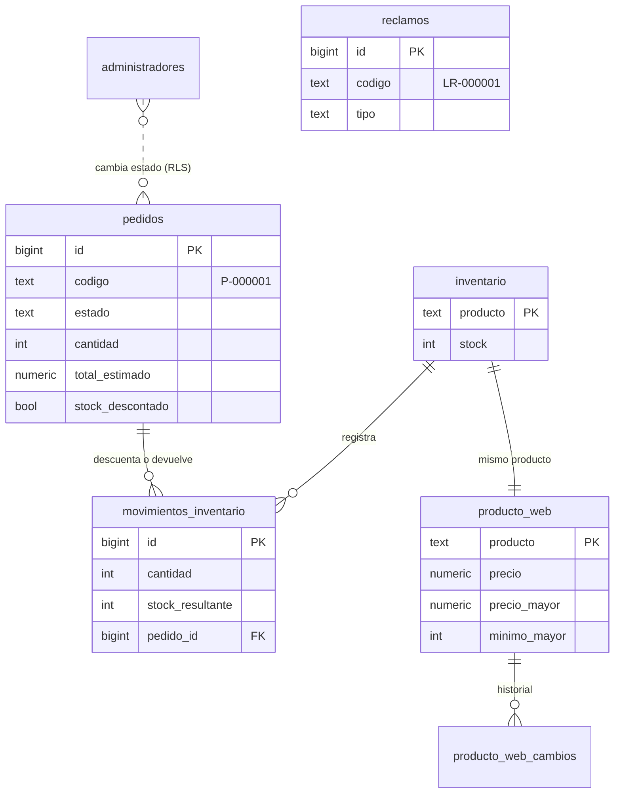

# Base de datos

PostgreSQL 17 en Supabase (proyecto `buuelzmvfidigimbrplm`, región São Paulo). Todo el esquema está en `supabase/migrations/`, en orden por fecha; nunca se cambia la base a mano sin dejar la migración en el repositorio.

## Reglas generales

- **RLS activo en todas las tablas.** El público (`anon`) no lee ni escribe ninguna tabla con datos personales. Lo que el público puede hacer pasa por una Edge Function (pedidos, libro) o por una función SQL que devuelve solo lo necesario (`seguir_pedido`).
- **Administradores**: un usuario de Supabase Auth cuyo correo está en `administradores`. La función `es_administrador()` lo comprueba en cada política; la página del panel no da permisos.
- **Números correlativos** generados por la base: `P-000001` para pedidos y `LR-000001` para hojas del libro (columnas `generated always`, nunca se reusan).
- **Funciones `security definer`** siempre con `set search_path = ''` y nombres con esquema, y con `execute` revocado a quien no las necesita.

## Tablas

| Tabla                       | Para qué                                                                                                                                                                                                                                                                      | Quién accede                                                                                                        |
| --------------------------- | ----------------------------------------------------------------------------------------------------------------------------------------------------------------------------------------------------------------------------------------------------------------------------- | ------------------------------------------------------------------------------------------------------------------- |
| `pedidos`                   | Cada pedido del formulario: cliente, celular, ciudad, presentación, cantidad, precio unitario, tipo de precio, entrega, total estimado, observaciones, `estado` (`nuevo`, `confirmado`, `pagado`, `enviado`, `entregado`, `cancelado`), `notas_internas`, `stock_descontado`. | Inserta la función `pedidos` (clave de servicio). Administradores: leer y cambiar solo `estado` y `notas_internas`. |
| `reclamos`                  | Hojas del Libro de Reclamaciones (Ley 29571): consumidor, documento, bien, detalle, pedido del consumidor, respuesta del proveedor y fechas de envío de correos.                                                                                                              | Inserta la función `libro-reclamaciones`. Sin acceso desde el panel todavía (se responde desde Supabase).           |
| `libro_proveedor`           | Una sola fila con los datos del proveedor que van en cada hoja (razón social, RUC, domicilio, correo).                                                                                                                                                                        | Solo la función del libro.                                                                                          |
| `administradores`           | Correos que pueden entrar al panel.                                                                                                                                                                                                                                           | Nadie desde la web; se edita en Supabase.                                                                           |
| `inventario`                | Stock actual por producto (`quimiver-50g`). Nunca negativo.                                                                                                                                                                                                                   | Solo por funciones (`ver_stock`, `ajustar_stock`, trigger de pedidos).                                              |
| `movimientos_inventario`    | Historial de stock: cantidad (+/-), stock resultante, motivo, pedido y quién lo hizo.                                                                                                                                                                                         | Igual que `inventario`.                                                                                             |
| `consultas_pedido_fallidas` | Intentos fallidos en "Sigue tu pedido", para frenar a quien prueba números.                                                                                                                                                                                                   | Solo `seguir_pedido`.                                                                                               |

Con el PR "Editar producto y precios desde el panel":

| Tabla                  | Para qué                                                                                                         | Quién accede                               |
| ---------------------- | ---------------------------------------------------------------------------------------------------------------- | ------------------------------------------ |
| `producto_web`         | Presentación, precio, precio por mayor, mínimo por mayor y dos textos del producto que la web usa al publicarse. | Todos leen; administradores cambian.       |
| `producto_web_cambios` | Antes, después, quién y cuándo de cada cambio de `producto_web`.                                                 | Administradores leen; lo llena un trigger. |

## Funciones y triggers

| Nombre                                            | Tipo                                           | Qué hace                                                                                                                                                                                              |
| ------------------------------------------------- | ---------------------------------------------- | ----------------------------------------------------------------------------------------------------------------------------------------------------------------------------------------------------- |
| `es_administrador()`                              | SQL, `authenticated`                           | Verdadero si el correo de la sesión está en `administradores`.                                                                                                                                        |
| `pedidos_stock`                                   | Trigger `before update of estado` en `pedidos` | Al pasar a un estado de venta descuenta los potes; al cancelar o volver a `nuevo` los devuelve. Si no alcanza el stock, el cambio de estado se rechaza (`P0001`).                                     |
| `mover_stock(producto, cantidad, motivo, pedido)` | Interna                                        | Cambio atómico de stock más su movimiento.                                                                                                                                                            |
| `ver_stock()`                                     | RPC, administradores                           | Stock y últimos 20 movimientos.                                                                                                                                                                       |
| `ajustar_stock(cantidad, motivo)`                 | RPC, administradores                           | Producción nueva o corrección.                                                                                                                                                                        |
| `seguir_pedido(codigo, telefono)`                 | RPC, público                                   | Si el código y el celular coinciden devuelve estado, fecha, presentación, cantidad, entrega y total; nunca nombre ni dirección. Bloquea tras 10 intentos fallidos por código o 300 en total por hora. |
| `producto_web_cambio`                             | Trigger (PR de producto)                       | Sella fecha y autor y guarda solo los campos que cambiaron.                                                                                                                                           |

## Diagrama

## Cómo cambiar el esquema

1. Crear `supabase/migrations/AAAAMMDDHHMMSS_nombre.sql` con comentarios en español que expliquen la regla de negocio.
2. Probarla en un PostgreSQL local con stubs de `anon`, `authenticated`, `auth.jwt()` y `auth.uid()` (ver `scripts/respaldo/restaurar.sh`, que los crea), incluidos los casos que deben fallar.
3. Aplicarla en Supabase con la misma SQL al publicar el PR. Evitar `DELETE` en migraciones aplicadas desde el conector (se queda esperando confirmación).
4. Revisar los avisos de seguridad de Supabase (Advisors) después de aplicarla.

Respaldos: ver `docs/respaldos.md` (PR "Respaldo semanal cifrado").
