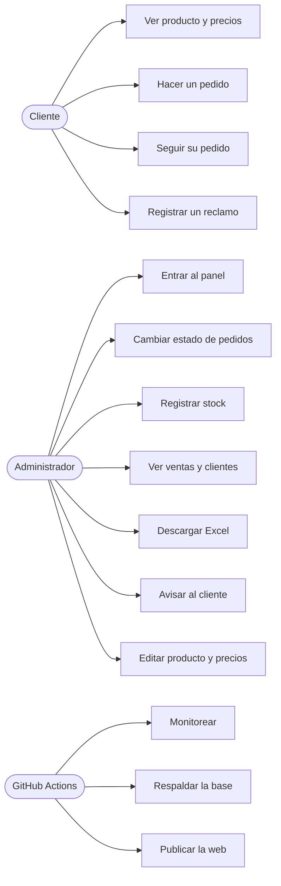
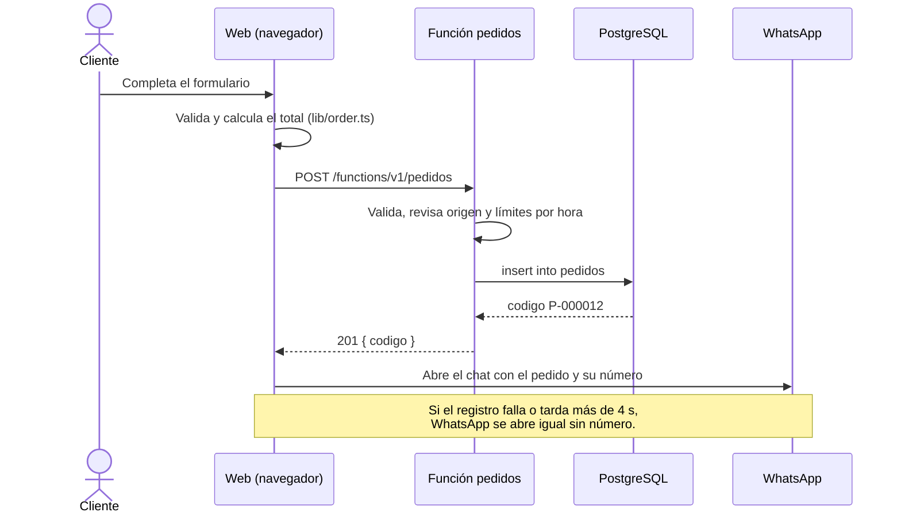
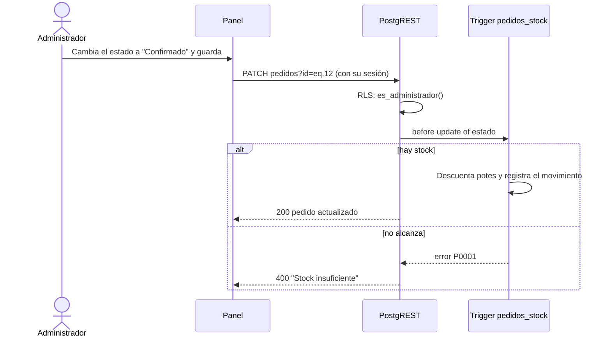
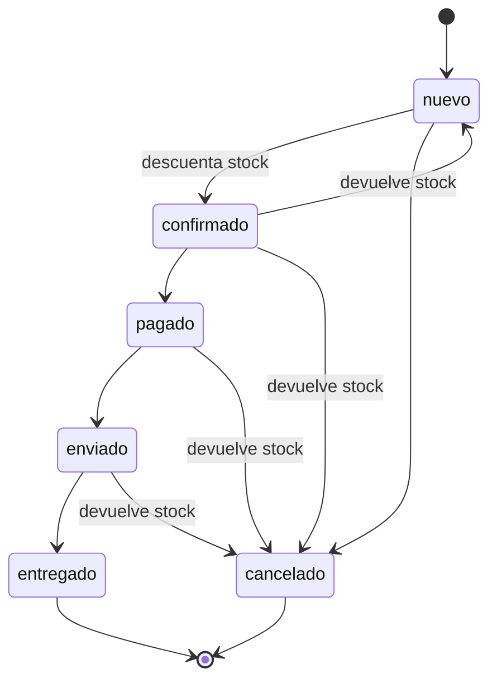

# Requisitos y diagramas

Requisitos tal como están implementados hoy. Cada uno dice dónde vive y cómo se prueba. Los marcados _(PR)_ llegan con un PR abierto.

## Requisitos funcionales

| Id    | Requisito                                                                                                                                  | Dónde                                                       | Prueba                                                  |
| ----- | ------------------------------------------------------------------------------------------------------------------------------------------ | ----------------------------------------------------------- | ------------------------------------------------------- |
| RF-01 | Mostrar el producto, su presentación, precio por unidad y precio por mayor desde un mínimo de unidades.                                    | `index.astro`, `productos/[slug].astro`, `PriceTable.astro` | `paginas.spec.ts`                                       |
| RF-02 | Ocultar todo dato no confirmado (afirmaciones de salud, testimonios, redes) hasta que se confirme.                                         | `content.config.ts` (`verified`)                            | Revisión manual; los componentes filtran por `verified` |
| RF-03 | Calcular el total estimado aplicando el precio por mayor desde el mínimo.                                                                  | `lib/order.ts`                                              | `order.test.ts`, `pedido.spec.ts`                       |
| RF-04 | Registrar el pedido con número correlativo P-000001 antes de abrir WhatsApp; abrir WhatsApp igual si el registro falla o tarda más de 4 s. | `scripts/order-form.ts`, función `pedidos`                  | `pedido.test.ts`, `pedido.spec.ts`                      |
| RF-05 | Validar el pedido en el servidor y limitar 5 pedidos por celular y 60 en total por hora.                                                   | `functions/pedidos`                                         | `pedido.test.ts`                                        |
| RF-06 | Mostrar "agotado" sin revelar el stock y seguir aceptando pedidos como reserva.                                                            | función `pedidos` (GET)                                     | `pedido.spec.ts`                                        |
| RF-07 | Permitir al cliente ver el estado de su pedido con número y celular, sin datos personales.                                                 | `seguimiento.astro`, `seguir_pedido`                        | `tracking.test.ts`, `seguimiento.spec.ts`               |
| RF-08 | Registrar hojas del Libro de Reclamaciones con número LR-000001 según la Ley 29571, con apoderado para menores.                            | `libro-de-reclamaciones.astro`, función del libro           | `complaint.test.ts`, `libro.spec.ts`                    |
| RF-09 | Dar acceso al panel solo a correos de `administradores`, con sesión que vence.                                                             | `panel.astro`, RLS                                          | `panel.spec.ts`, pruebas de RLS                         |
| RF-10 | Listar pedidos, filtrarlos por estado y cambiar estado y notas internas.                                                                   | `scripts/panel.ts`                                          | `panel.test.ts`, `panel.spec.ts`                        |
| RF-11 | Descontar stock al confirmar un pedido, devolverlo al cancelar y rechazar la confirmación si no alcanza.                                   | trigger `pedidos_stock`                                     | pruebas SQL, `panel.spec.ts`                            |
| RF-12 | Registrar producción nueva con motivo y mostrar el historial; avisar con 10 potes o menos.                                                 | `ajustar_stock`, panel                                      | `panel.test.ts`, `panel.spec.ts`                        |
| RF-13 | Resumen de ventas: semana, mes, desde el inicio, últimos 6 meses y 5 ciudades.                                                             | `summarizeSales`                                            | `panel.test.ts`, `panel.spec.ts`                        |
| RF-14 | Descargar los pedidos visibles en Excel.                                                                                                   | `lib/xlsx.ts`                                               | `xlsx.test.ts`, `panel.spec.ts`                         |
| RF-15 | Avisar al cliente por WhatsApp del estado de su pedido con el enlace de seguimiento.                                                       | `customerNotice`                                            | `panel.test.ts`                                         |
| RF-16 | Ver clientes agrupados por celular, buscarlos y descargarlos en Excel. _(PR)_                                                              | `summarizeCustomers`                                        | `clientes.test.ts`, `panel.spec.ts`                     |
| RF-17 | Editar presentación, precios, mínimo por mayor y textos desde el panel, con historial. _(PR)_                                              | `producto_web`, `panel-product.ts`                          | `product-data.test.ts`, `panel.spec.ts`                 |
| RF-18 | Recuperar la contraseña del panel por correo. _(PR)_                                                                                       | `panel-recovery.ts`                                         | `auth.test.ts`, `panel.spec.ts`                         |
| RF-19 | Avisar en GitHub si la web o los servidores dejan de responder.                                                                            | `scripts/monitoreo.mjs`                                     | `monitoreo.test.ts`                                     |
| RF-20 | Copia semanal cifrada de la base, probada restaurándola. _(PR)_                                                                            | `scripts/respaldo/`                                         | prueba de restauración en el flujo                      |

## Requisitos no funcionales

| Id     | Requisito                 | Cómo se cumple                                                                                             |
| ------ | ------------------------- | ---------------------------------------------------------------------------------------------------------- |
| RNF-01 | Rendimiento               | Lighthouse 98–100 en celular; imágenes WebP con carga diferida; fuentes propias.                           |
| RNF-02 | Responsive                | Probado de 320 px a escritorio; pruebas en navegador en Pixel 7.                                           |
| RNF-03 | Accesibilidad WCAG 2.1 AA | axe en todas las páginas, "Saltar al contenido", foco visible, etiquetas y errores asociados.              |
| RNF-04 | Seguridad                 | RLS, validación en el servidor, CSP, límites por hora, sin secretos en el código (`docs/seguridad.md`).    |
| RNF-05 | Privacidad                | Ley 29733: consentimiento en formularios y política publicada; el seguimiento no muestra datos personales. |
| RNF-06 | Disponibilidad            | Monitoreo cada 6 horas; si falla el registro, el pedido sigue por WhatsApp.                                |
| RNF-07 | Costo                     | Planes gratuitos de GitHub Pages y Supabase.                                                               |

## Casos de uso

## Secuencia: hacer un pedido

## Secuencia: confirmar un pedido en el panel

## Estados del pedido

El panel permite cualquier cambio de estado (por ejemplo, corregir un error); el trigger mantiene el stock correcto en todos los casos.
